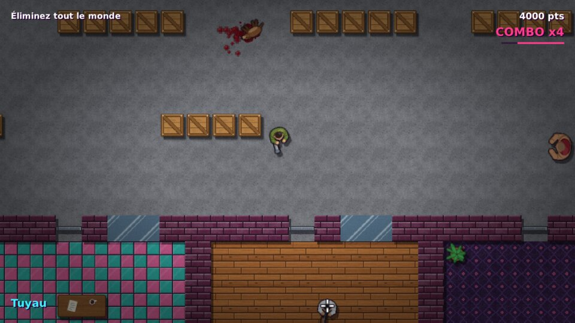
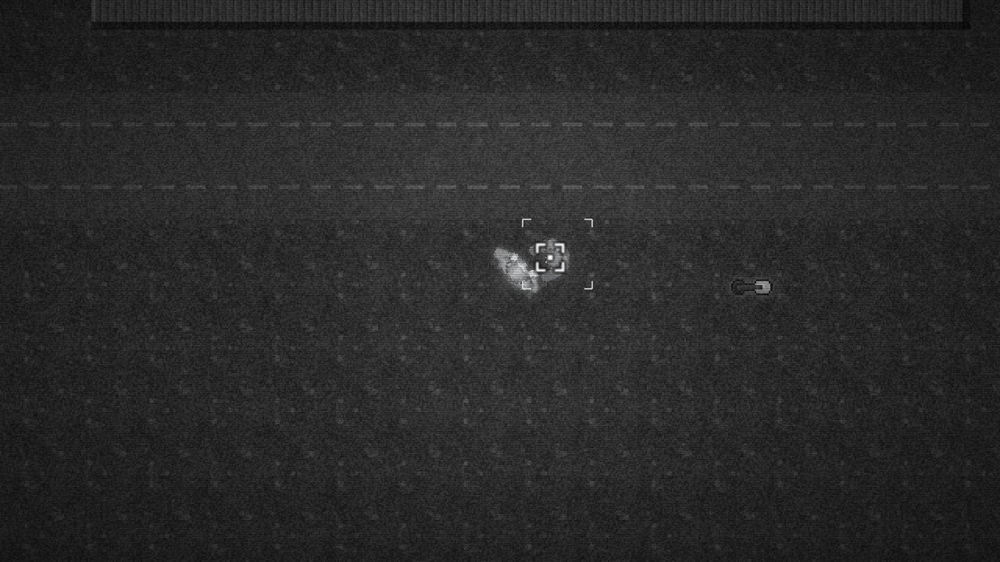
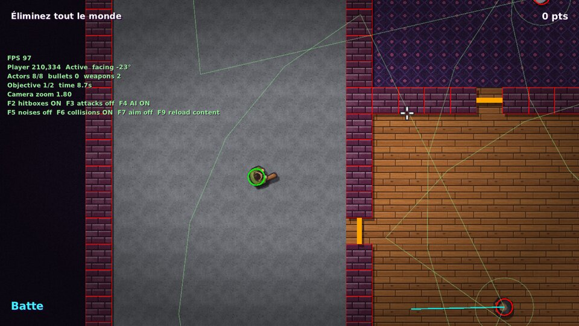
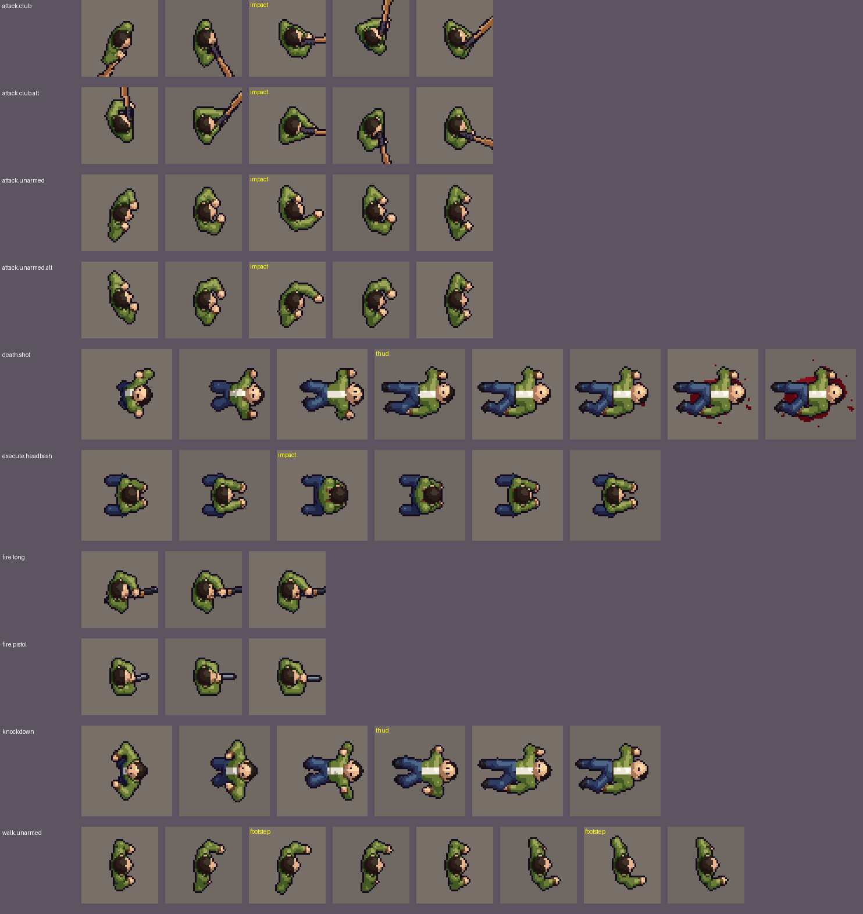
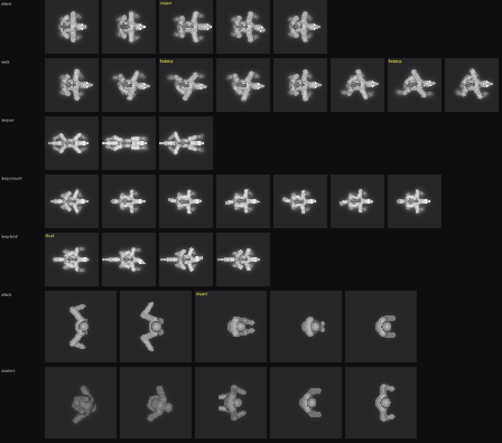

# TopDown — moteur de jeux d'action 2D vu du dessus

Socle C# / MonoGame pour des jeux d'action 2D vus du dessus, rapides et létaux. Le moteur connaît
les **règles** (déplacements, collisions, combat, IA, portes, objectifs) ; les **jeux** sont des données
(JSON, images, sons) chargées au lancement.

Plusieurs jeux tournent sur le même exécutable ; on les choisit dans le menu principal (« Jeu ») ou
avec `--profile` :

| Profil | Contenu | Style |
|---|---|---|
| `action` | `Content/Base` | « Néon brutal » : action nerveuse, un coup = un mort (ou un blessé qui rampe, ou un corps démembré), score et combos |
| `noct` | `Content/Base` + `Mods/NoctPrototype` | « Le dernier signal » : survival horror vu par une caméra thermique de surveillance, trois créatures, une mission |
| `signal` | `Content/Base` + `Mods/NoctInspired` | « Signal mort » : ancienne démo de mod (horreur thermique, deux niveaux) |

| Action (`action`, scène `demo`) | Horreur (`noct`, scène `noct_demo`) | Mode debug |
|---|---|---|
|  |  |  |

Personnages et créatures sont animés (marche, coups, tirs, chutes, morts selon les dégâts, achèvements ;
bond en trois phases, réveil du veilleur) par un système piloté par les données
([animation.md](docs/animation.md)) :




Tout le contenu (graphismes, sons, niveaux, textes) est original. Les graphismes et sons de
remplacement sont générés par `tools/PlaceholderArt` (CC0).

## Prérequis

- [SDK .NET 10](https://dotnet.microsoft.com/download) (macOS, Windows ou Linux).
- Rien d'autre : MonoGame et FontStashSharp arrivent par NuGet, le jeu n'utilise pas le content pipeline de MonoGame.

## Compiler, tester, jouer

```bash
dotnet build TopDown.slnx
```

```bash
dotnet test tests/TopDown.Tests
```

```bash
dotnet run --project src/TopDown.Desktop
```

```bash
dotnet run --project src/TopDown.Desktop -- --profile noct
```

Sur macOS, les mêmes commandes s'utilisent dans Terminal (Apple Silicon et Intel). Pour une version
autonome :

```bash
dotnet publish src/TopDown.Desktop -c Release -r osx-arm64 --self-contained
```

(`osx-x64`, `win-x64`, `linux-x64` pour les autres plateformes.) Les dossiers `Content/` et `Mods/`
sont copiés à côté de l'exécutable et restent modifiables sans recompiler.

### Options de lancement

| Option | Effet |
|---|---|
| `--profile <id>` | profil de `Content/profiles.json` (`action`, `noct`) |
| `--mod <id>` | charge en plus un mod installé (répétable) |
| `--level <id>` | démarre directement un niveau |
| `--lang <code>` | langue (`fr`, `en`) |
| `--content <dir>` / `--mods <dir>` | autres dossiers de contenu ou de mods |
| `--size 1600x900`, `--mute` | taille de fenêtre, sans son |
| `--autopilot --frames N --screenshot f.png` | le jeu joue seul, s'arrête après N images et enregistre la dernière (tests de fumée) |
| `--modifier <id>` | joue avec ce modificateur (remplace le choix enregistré) |

Scènes de démonstration (aussi dans le menu des niveaux) :

```bash
dotnet run --project src/TopDown.Desktop -- --profile action --level demo
```

```bash
dotnet run --project src/TopDown.Desktop -- --profile noct --level noct_demo
```

## Commandes

| Action | Par défaut |
|---|---|
| Se déplacer | ZQSD (AZERTY) **et** WASD (QWERTY), flèches |
| Viser | souris |
| Attaquer | clic gauche (maintenu pour les armes automatiques) |
| Ramasser / lancer l'arme | clic droit (échange si une arme est au sol) |
| Achever un ennemi à terre, qui se relève ou qui rampe blessé / interagir | Espace (aux poings, puis clic gauche pour chaque coup : à cheval, la tête cognée au sol, ou coups de pied ; un chien y laisse ses pattes ou sa tête) |
| Verrouiller une cible | clic molette ou E |
| Regarder plus loin | Maj |
| Courir (jeux avec endurance) | Maj (maintenu) |
| Recharger (armes à munitions de réserve) | R (et automatiquement sur un chargeur vide) |
| Se soigner (trousse) | H |
| Recommencer | R (dans « Le dernier signal » : après la mort, ou depuis la pause, puisque R recharge) |
| Pause | Échap ou P |
| Plein écran | F11 |

Un repère discret entoure l'ennemi que vous pouvez achever. La **salle d'essai** (menu Jouer, après la
campagne, ou `--level arena`) réunit un ennemi seul, un chien, deux ennemis ensemble, une batte, un
tuyau et un pistolet pour tester les combats. Les réglages de rythme sont dans `Content/Base/game.json` (`rules`,
`feel`), les armes et les personnages (voir [docs/content.md](docs/content.md)) ; `F9` les recharge.

### Le dernier signal (prototype Noct)

```bash
dotnet run --project src/TopDown.Desktop -- --profile noct
```

Un survivant reçoit une transmission venant d'une installation abandonnée : traverser la cour,
explorer le bâtiment, récupérer une batterie radio dans la salle radio, revenir au point d'extraction.
L'observateur commente par radio. Trois créatures : le **Charognard** (chasse en meute), le
**Bondisseur** (se ramasse, crie, puis bondit en ligne droite : écartez-vous juste après le saut) et le
**Veilleur** (immobile et presque froid à l'image, il respire ; il se réveille si l'on s'approche).
Munitions de réserve par calibre, rechargement, trousses de soins, course avec endurance (bruyante),
casiers et caisses à fouiller. Tout est dans `Mods/NoctPrototype` (données, images, sons, textes) ; le
jeu d'action n'est pas modifié. Pour revenir au jeu d'action : menu « Jeu », ou `--profile action`
(le dernier jeu choisi est retenu au lancement suivant).

Toutes les touches se changent dans `settings.json`, dans le dossier utilisateur dont le chemin
exact est affiché en bas du menu Paramètres (par exemple `~/.config/TopDown` sous Linux,
`%APPDATA%\TopDown` sous Windows) :

```json
{ "bindings": { "Attack": ["Mouse:Left", "J"], "Interact": ["Space", "F"] } }
```

### Mode debug (désactivé par défaut)

`F1` panneau (FPS, position, états), `F2` hitboxes, `F3` zones d'attaque et origines des tirs,
`F4` IA (vision, état, chemins), `F5` bruits, `F6` collisions, `F7` visée, `F9` recharge le contenu
depuis le disque (modifier un JSON, appuyer sur F9, voir le résultat). Les erreurs de contenu sont
listées dans le menu et dans `log.txt` (dossier utilisateur).

## Structure

```text
src/TopDown.Core      règles du jeu, sans rendu ni fichiers (testable sans fenêtre)
src/TopDown.Content   chargement et validation des packs, mods, ressources, traductions
src/TopDown.Desktop   MonoGame : fenêtre, rendu, audio, entrées, menus, HUD
tests/TopDown.Tests   tests xUnit (logique, contenu, mods, traductions)
tools/PlaceholderArt  générateur des graphismes et sons (squelette d'animation dans Rig/)
Content/Base          contenu de démonstration (jeu d'action)
Content/profiles.json profils = ensembles de mods
Mods/NoctPrototype    « Le dernier signal » (horreur thermique)
Mods/NoctInspired     conversion horreur (exemple de mod complet)
docs/                 formats et guides
```

## Documentation

- [Architecture et choix techniques](docs/architecture.md)
- [Format du contenu (armes, personnages, tuiles, thèmes, ressources)](docs/content.md)
- [Format des niveaux](docs/levels.md)
- [Créer un mod](docs/modding.md)
- [Animations des personnages](docs/animation.md)
- Chartes graphiques : [pack action](docs/art/action.md), [pack thermique](docs/art/thermal.md)
- [Revue visuelle et comparaison aux références](docs/art/visual-review.md)
- [Traductions](docs/localization.md)

## État et limites

- **Vérifié** :
  - ici (Linux, Xvfb, OpenGL logiciel) : compilation sans avertissement, tests, menus, tous les
    niveaux en pilotage automatique (la mission du « Dernier signal » jouée de bout en bout jusqu'à
    l'extraction), et une partie pilotée au clavier et à la souris (menu, ramassage, attaque, pause,
    mode debug, recommencement) ;
  - en intégration continue (`.github/workflows/ci.yml`) : compilation et tests sous **Linux et Windows**,
    et le jeu réel sur tous les niveaux sous Linux, à chaque pull request et à chaque push sur `main`.
    **macOS** (compilation, tests, jeu lancé et rendu sur Apple Silicon) seulement à la demande, pour
    économiser les minutes : onglet Actions, « CI », « Run workflow », case « Also run on macOS ».
- **Non vérifié** : une vraie session de jeu sur un Mac ou un PC Windows avec carte graphique, et le son
  et les musiques (pas de carte son dans l'environnement de développement : le jeu le détecte et
  continue sans audio ; les musiques sont contrôlées par mesures de volume, de spectre et de bouclage).
- Post-traitement sans shaders compilés (le compilateur d'effets de MonoGame exige Wine hors Windows) :
  obscurité, lumières, grain, vignette, lignes de balayage et parasites sont faits par mélanges de
  couleurs. Le rendu thermique repose sur des images en niveaux de gris (générées, remplaçables), un halo
  de chaleur autour des corps, la luminosité propre à chaque créature et ces effets, tous réglables dans
  le thème du pack.
- Pas de manette, pas d'éditeur de niveaux, pas de scripts dans les mods (choix volontaires pour cette
  première version), les ennemis ne ramassent pas les armes.
- Graphismes : tous générés par le dépôt (squelette d'animation, meubles et structures en volume, tuiles) ;
  les créatures de `NoctInspired` gardent leurs anciens sprites fixes. Les
  vidéos de référence n'ont pas pu être visionnées et aucun service externe de génération n'a été
  utilisé : voir la [revue visuelle](docs/art/visual-review.md).
