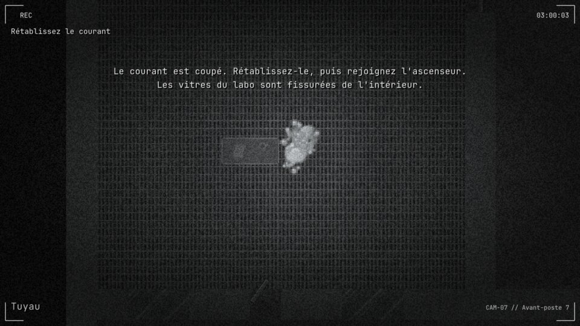

# TopDown — moteur de jeux d'action 2D vu du dessus

Socle C# / MonoGame pour des jeux d'action 2D vus du dessus, rapides et létaux. Le moteur connaît
les **règles** (déplacements, collisions, combat, IA, portes, objectifs) ; les **jeux** sont des données
(JSON, images, sons) chargées au lancement.

Deux expériences tournent déjà sur le même exécutable :

| Profil | Contenu | Style |
|---|---|---|
| `action` | `Content/Base` | « Néon brutal » : action nerveuse, un coup = un mort, score et combos |
| `noct` | `Content/Base` + `Mods/NoctInspired` | « Signal mort » : horreur de surveillance thermique, obscurité, créatures qui chassent au bruit, sans score |

| Action (`action`) | Horreur (`noct`) | Mode debug |
|---|---|---|
|  |  |  |

Tout le contenu (graphismes, sons, niveaux, textes) est original. Les graphismes et sons de
remplacement sont générés par `tools/PlaceholderArt` (CC0).

## Prérequis

- [SDK .NET 10](https://dotnet.microsoft.com/download) (macOS, Windows ou Linux).
- Rien d'autre : MonoGame et FontStashSharp arrivent par NuGet, le jeu n'utilise pas le content pipeline de MonoGame.

## Compiler, tester, jouer

```bash
dotnet build TopDown.slnx
```

```bash
dotnet test tests/TopDown.Tests
```

```bash
dotnet run --project src/TopDown.Desktop
```

```bash
dotnet run --project src/TopDown.Desktop -- --profile noct
```

Sur macOS, les mêmes commandes s'utilisent dans Terminal (Apple Silicon et Intel). Pour une version
autonome :

```bash
dotnet publish src/TopDown.Desktop -c Release -r osx-arm64 --self-contained
```

(`osx-x64`, `win-x64`, `linux-x64` pour les autres plateformes.) Les dossiers `Content/` et `Mods/`
sont copiés à côté de l'exécutable et restent modifiables sans recompiler.

### Options de lancement

| Option | Effet |
|---|---|
| `--profile <id>` | profil de `Content/profiles.json` (`action`, `noct`) |
| `--mod <id>` | charge en plus un mod installé (répétable) |
| `--level <id>` | démarre directement un niveau |
| `--lang <code>` | langue (`fr`, `en`) |
| `--content <dir>` / `--mods <dir>` | autres dossiers de contenu ou de mods |
| `--size 1600x900`, `--mute` | taille de fenêtre, sans son |
| `--autopilot --frames N --screenshot f.png` | le jeu joue seul, s'arrête après N images et enregistre la dernière (tests de fumée) |

## Commandes

| Action | Par défaut |
|---|---|
| Se déplacer | ZQSD (AZERTY) **et** WASD (QWERTY), flèches |
| Viser | souris |
| Attaquer | clic gauche (maintenu pour les armes automatiques) |
| Ramasser / lancer l'arme | clic droit (échange si une arme est au sol) |
| Achever un ennemi à terre ou qui se relève / interagir | Espace (aux poings, puis clic gauche pour chaque coup) |
| Verrouiller une cible | clic molette ou E |
| Regarder plus loin | Maj |
| Recommencer | R |
| Pause | Échap ou P |
| Plein écran | F11 |

Un repère discret entoure l'ennemi que vous pouvez achever. La **salle d'essai** (menu Jouer, après la
campagne, ou `--level arena`) réunit un ennemi seul, deux ennemis ensemble, une batte, un tuyau et un
pistolet pour tester les combats. Les réglages de rythme sont dans `Content/Base/game.json` (`rules`,
`feel`), les armes et les personnages (voir [docs/content.md](docs/content.md)) ; `F9` les recharge.

Toutes les touches se changent dans `settings.json`, dans le dossier utilisateur dont le chemin
exact est affiché en bas du menu Paramètres (par exemple `~/.config/TopDown` sous Linux,
`%APPDATA%\TopDown` sous Windows) :

```json
{ "bindings": { "Attack": ["Mouse:Left", "J"], "Interact": ["Space", "F"] } }
```

### Mode debug (désactivé par défaut)

`F1` panneau (FPS, position, états), `F2` hitboxes, `F3` zones d'attaque et origines des tirs,
`F4` IA (vision, état, chemins), `F5` bruits, `F6` collisions, `F7` visée, `F9` recharge le contenu
depuis le disque (modifier un JSON, appuyer sur F9, voir le résultat). Les erreurs de contenu sont
listées dans le menu et dans `log.txt` (dossier utilisateur).

## Structure

```text
src/TopDown.Core      règles du jeu, sans rendu ni fichiers (testable sans fenêtre)
src/TopDown.Content   chargement et validation des packs, mods, ressources, traductions
src/TopDown.Desktop   MonoGame : fenêtre, rendu, audio, entrées, menus, HUD
tests/TopDown.Tests   tests xUnit (logique, contenu, mods, traductions)
tools/PlaceholderArt  générateur des graphismes et sons de remplacement
Content/Base          contenu de démonstration (jeu d'action)
Content/profiles.json profils = ensembles de mods
Mods/NoctInspired     conversion horreur (exemple de mod complet)
docs/                 formats et guides
```

## Documentation

- [Architecture et choix techniques](docs/architecture.md)
- [Format du contenu (armes, personnages, tuiles, thèmes, ressources)](docs/content.md)
- [Format des niveaux](docs/levels.md)
- [Créer un mod](docs/modding.md)
- [Traductions](docs/localization.md)

## État et limites

- **Vérifié** :
  - ici (Linux, Xvfb, OpenGL logiciel) : compilation sans avertissement, tests, menus, les cinq
    niveaux en pilotage automatique, et une partie pilotée au clavier et à la souris (menu, ramassage,
    attaque, pause, mode debug, recommencement) ;
  - en intégration continue (`.github/workflows/ci.yml`) : compilation et tests sous **Linux, Windows et
    macOS** ; le jeu réel sur les cinq niveaux sous Linux ; le jeu lancé et rendu sous **macOS** (Apple
    Silicon) sur un niveau.
- **Non vérifié** : une vraie session de jeu sur un Mac ou un PC Windows avec carte graphique, et le son
  et les musiques (pas de carte son dans l'environnement de développement : le jeu le détecte et
  continue sans audio ; les musiques sont contrôlées par mesures de volume, de spectre et de bouclage).
- Post-traitement sans shaders compilés (le compilateur d'effets de MonoGame exige Wine hors Windows) :
  obscurité, lumières, grain, vignette, lignes de balayage et parasites sont faits par mélanges de
  couleurs. Un vrai rendu thermique (conversion en niveaux de gris) passe par des sprites adaptés, comme
  le fait le mod.
- Pas de manette, pas d'éditeur de niveaux, pas de scripts dans les mods (choix volontaires pour cette
  première version), les ennemis ne ramassent pas les armes.
