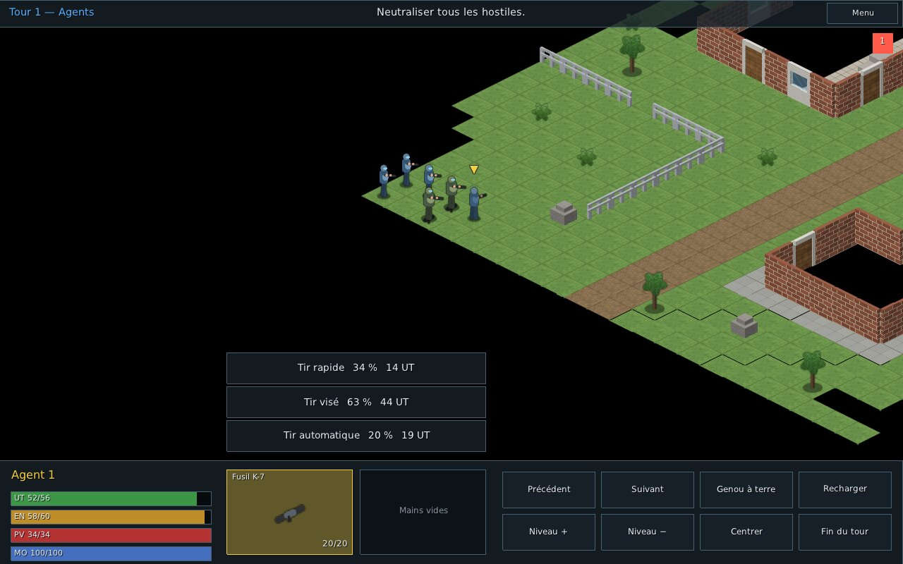
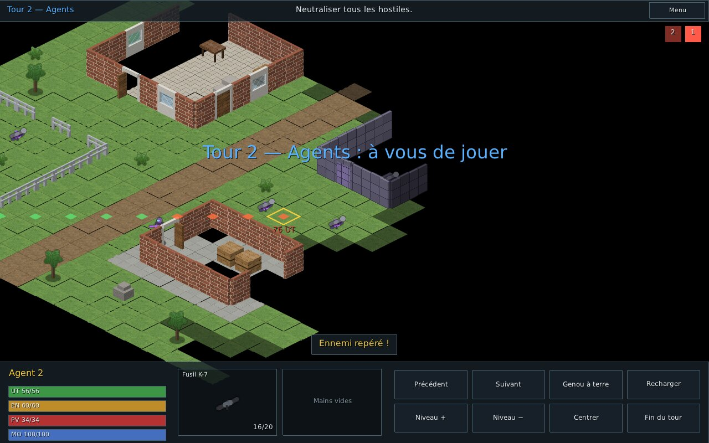
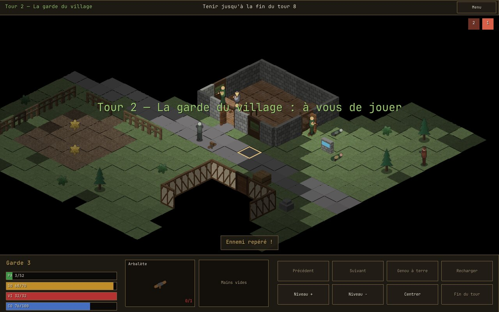

# OpenTactics — recréation en C# des mécaniques d'OpenXcom Extended

Jeu tactique au tour par tour en vue isométrique, écrit en C# (.NET 10, MonoGame), qui reproduit
les règles d'[OpenXcom Extended](https://github.com/MeridianOXC/OpenXcom) : unités de temps, tirs
déviés voxel par voxel, tirs de réaction, armures par face, blessures, moral, vision et lumière,
brouillard de guerre, IA. Le moteur ne connaît que les règles ; les univers sont des **packs de
contenu** (JSON, images, sons, textes) chargés au lancement.

Deux univers tournent sur le même exécutable :

| Pack | Univers | Missions |
|---|---|---|
| `horizon` (A) | Science-fiction proche : des agents contre des visiteurs venus d'ailleurs | éliminer, extraction de nuit, carte générée par blocs |
| `mistvale` (B) | Vallée médiévale : la garde d'un village contre pillards et revenants | tenir jusqu'à l'aube, atteindre le pont |

| Menu d'action (pack A) | Nouveau tour (pack A) | Pack B, de nuit |
|---|---|---|
|  |  |  |

Tout le contenu est original. Les images et sons de remplacement sont générés par
`tools/PlaceholderArt` (domaine public, CC0) ; les polices sont libres (DejaVu, JetBrains Mono).

## Prérequis

- [SDK .NET 10](https://dotnet.microsoft.com/download) (macOS Apple Silicon ou Intel, Linux, Windows).
- Rien d'autre : MonoGame et FontStashSharp arrivent par NuGet ; aucun service en ligne, aucun compte.

## Commandes

```bash
dotnet build Game.slnx
```

```bash
dotnet test tests/Game.Tests
```

```bash
dotnet run --project src/Game.Desktop
```

Mission de démonstration directe (graine fixe : même carte, mêmes tirages) :

```bash
dotnet run --project src/Game.Desktop -- --pack horizon --mission first_contact --seed 1
```

Le second univers, et le mod d'exemple :

```bash
dotnet run --project src/Game.Desktop -- --pack mistvale
```

```bash
dotnet run --project src/Game.Desktop -- --pack horizon --mod horizon_arsenal
```

### Sous macOS

Les mêmes commandes s'utilisent dans Terminal, sur Apple Silicon comme sur Intel. Pour une version
autonome (sans SDK sur la machine cible) :

```bash
dotnet publish src/Game.Desktop -c Release -r osx-arm64 --self-contained
```

(`osx-x64`, `linux-x64`, `win-x64` pour les autres plateformes.) Les dossiers `Content/` et `Mods/`
sont copiés à côté de l'exécutable et restent modifiables sans recompiler. Les réglages et le journal
(`settings.json`, `log.txt`) sont dans le dossier utilisateur dont le chemin est écrit au démarrage.

### Options de lancement

| Option | Effet |
|---|---|
| `--pack <id>` | pack de jeu (`horizon`, `mistvale`) |
| `--mod <id>` | charge aussi un mod installé (répétable) |
| `--mission <id>` | démarre directement une mission |
| `--seed <n>` | graine de la bataille |
| `--lang <code>` | langue (`fr`, `en`) |
| `--size 1600x900`, `--mute` | taille de la fenêtre, sans son |
| `--autoplay` | l'IA joue aussi votre camp (démonstration) |
| `--frames N --screenshot f.png` | s'arrête après N images et enregistre la dernière (tests de fumée) |

## Commandes de jeu

| Action | Par défaut |
|---|---|
| Sélectionner une unité | clic gauche sur elle, `Tab` / `Maj+Tab` |
| Se déplacer | clic gauche sur une case (le chemin et son coût s'affichent au survol ; vert = payable) |
| Se tourner | clic droit sur une case |
| Tirer | clic sur l'arme en main → mode (précision et UT affichées) → clic sur la cible ; clic droit ou `Échap` annule |
| Genou à terre / debout | `K` |
| Recharger | `R` |
| Inventaire (prendre une grenade en main, ramasser, poser) | `I` |
| Réserver des UT pour la réaction | boutons « Réserve » et « +Genou » en haut de l'écran |
| Grenade | en main : clic sur elle → « Amorcer » puis « Lancer » → case ; elle explose en fin de tour |
| Fin du tour | `E` |
| Caméra | flèches, ZQSD/WASD, bords de l'écran, clic molette maintenu ; zoom à la molette ; `C` centre |
| Niveaux | `Page préc.` / `Page suiv.` |
| Menu | `Échap` |
| Tout montrer (débogage) | `F1` |
| Plein écran | `F11` |

Les touches se changent dans `settings.json` :

```json
{ "bindings": { "EndTurn": ["Enter"], "Kneel": ["K", "Mouse:X1"] } }
```

## Structure

```text
src/Game.Core       règles et simulation, chargement et validation du contenu (sans MonoGame)
src/Game.Desktop    MonoGame : fenêtre, rendu isométrique, interface, entrées, sons
tests/Game.Tests    tests xUnit (règles, contenu, mods, traductions, IA)
tools/PlaceholderArt  générateur des images et sons de remplacement
Content/horizon     pack A
Content/mistvale    pack B
Mods/horizon_arsenal  mod d'exemple (ajoute, modifie, remplace)
docs/               documentation
```

## Documentation

- [Mécaniques : ce qui est reproduit, partiel ou manquant](docs/mechanics.md)
- [Architecture et choix techniques](docs/architecture.md)
- [Format du contenu](docs/content.md)
- [Créer un mod](docs/modding.md)

## État

**Fait (lots 0 et 1, avec une partie du lot 2)** : combat tactique jouable de bout en bout — carte
isométrique sur plusieurs niveaux avec escaliers, portes, fenêtres et décor destructible ;
déplacements et coûts en UT ; tirs rapides, visés et en rafale avec la déviation d'OXCE ;
munitions et rechargement ; mêlée ; dégâts par face d'armure, étourdissement, blessures mortelles,
mort ; tirs de réaction ; vision, lumière et brouillard de guerre ; moral ; IA ; objectifs
(élimination, tenir N tours, atteindre une zone, limite de tours) ; cartes fixes ou générées par
blocs ; deux univers ; mods ; FR/EN.

Grenades (amorçage, lancer en cloche, explosion en fin de tour, destruction du décor) et
inventaire (déplacement d'objets avec les coûts en UT), réserve d'UT, panique et berserk sont aussi
en place.

**Pas encore fait** : feu et fumée, sauvegarde, expérience, inventaire en
grille, grenades pour l'IA, et toute la couche stratégique (Geoscape). Le détail est dans
[docs/mechanics.md](docs/mechanics.md).

**Vérifié** : compilation sans avertissement et 102 tests sous Linux ; le jeu réel lancé sous Linux
(Xvfb, OpenGL logiciel), joué à la souris et au clavier (sélection, déplacement, menu de tir, tir,
fin de tour, inventaire, grenade amorcée, lancée et explosant en fin de tour) et en pilotage
automatique sur les deux packs. L'intégration continue
(`.github/workflows/ci.yml`) compile et teste sous Linux, Windows et macOS. **Non vérifié** : une
vraie session sur un Mac, et le son (pas de carte son dans l'environnement de développement).

## Licences

Le code de ce dépôt est une implémentation indépendante : les règles ont été étudiées dans les
sources d'OpenXcom/OXCE (GPL v3) puis réécrites, sans copie de code. Aucun graphisme, son ou texte
des jeux X-COM ou d'OpenXcom n'est utilisé.
