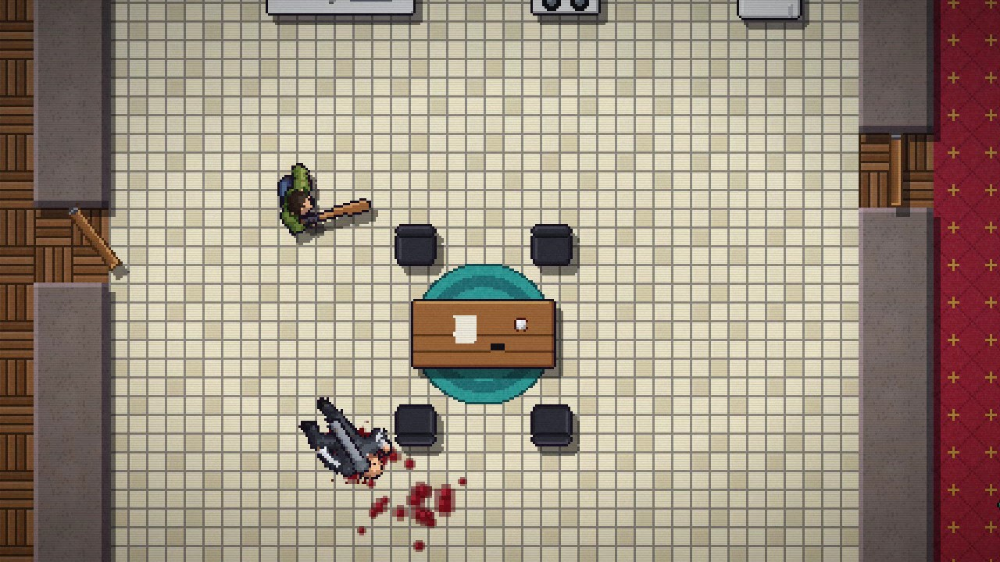
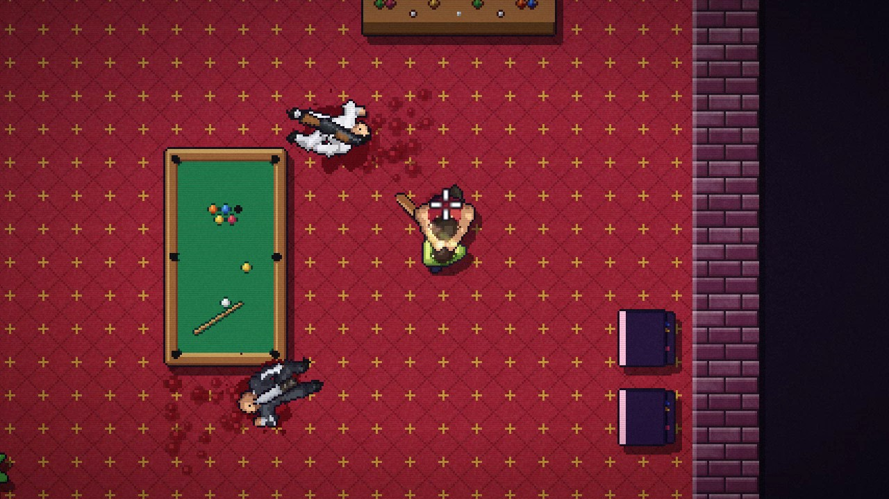
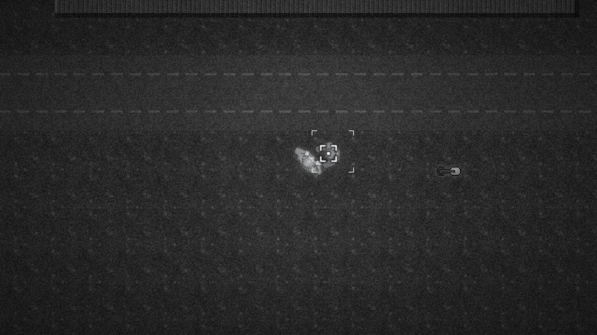

# Revue visuelle (fidélité aux références)

Ce document dit ce qui a été **observé**, comment, et ce qui ne l'a pas été.

## Références consultées

| Référence | Accès | Usage |
|---|---|---|
| hotlinemiami.com | refusé aux requêtes automatisées | non consultée |
| Vidéo de gameplay de Noct (jeuxvideo.com) | lecture vidéo impossible dans l'environnement de développement | **non analysée** |
| Vidéos de Noct sur moddb | idem | **non analysées** |
| Captures de la page Steam de Hotline Miami et de Noct | téléchargées hors du dépôt, regardées image par image | proportions, densité du décor, palette, cadrage, HUD |

Aucune image de ces jeux n'est dans le dépôt ; aucun sprite n'en a été repris.

**Retro Diffusion** : les outils sont présents dans l'environnement mais aucune clé d'API n'est configurée.
Rien n'a été généré avec ; tous les graphismes viennent du générateur du dépôt.

## Ce qui a été observé

- Planches d'animation agrandies (×3 à ×5) de chaque clip des quatre humains, des trois créatures et du
  survivant thermique.
- Jeu réel sous Xvfb, en 720p (pixels ×2) et en 1080p (pixels ×3) :
  - scène `demo` du pack action et scène `noct_demo` du pack thermique, jouées par le pilote automatique ;
  - pour l'enregistrement uniquement (hors dépôt), un modificateur d'invulnérabilité et une variante
    désarmée de `noct_demo`, pour que les créatures aient le temps de charger, bondir et s'éveiller ;
  - vidéos et planches d'images extraites, recadrées autour du joueur.
- Tous les niveaux des trois profils lancés en pilote automatique (sans avertissement) ; la mission
  « Le dernier signal » jouée jusqu'à l'extraction.

## Captures (jeu réel, 1080p, pixels ×3)

| Cuisine de la scène `demo` | Salle de billard | Pack thermique, scène `noct_demo` |
|---|---|---|
|  |  |  |

## Comparaison — pack action

| Critère | Constat |
|---|---|
| Densité du décor | pièces meublées (salon, cuisine, billard et bar, hall, salle de bain, bureaux, rue) et sols variés : bien plus proche des intérieurs du genre qu'avant. Encore moins de petit désordre (bouteilles, papiers, affiches) que la référence |
| Proportions | vue de dessus, tête ≈ 45 % de la largeur des épaules : conforme aux captures de référence |
| Silhouettes | lisibles à ×3 ; à ×2 (720p) les personnages font 22 px de large, comme dans le genre |
| Mouvement | marche en 8 images avec jambes séparées, coups en 4 à 5 images, chutes en 6, morts en 8 : lisible et vif. Les animations dessinées à la main de la référence ont plus d'images et plus d'exagération |
| Transitions | chute, mort, relevé et achèvements sont animés ; le relevé se termine par un demi-tour rapide un peu artificiel |
| Lisibilité des impacts | l'image de contact tombe exactement au moment du coup (calée sur l'événement `impact`) ; sang, secousse et à-coup de caméra existants |
| Ambiance | palette néon saturée et pixels nets. Pas d'ondulation ni de cycle de couleurs plein écran comme la référence : pas de shader global, par choix |

Points faibles connus :
- les jambes ne distinguent pas la marche en crabe de la marche avant ;
- à cheval, le bourreau cache une grande partie de sa victime : sa réaction se voit surtout aux bras et aux
  jambes ;
- quand un chien est démembré, ses morceaux restent fixes (ils sont tirés, pas animés).

Le chien (galop, morsure, chute, mort, achèvement) et la victime d'un achèvement (protection, sursaut à
chaque coup, inertie) ont été ajoutés ensuite et vérifiés en jeu réel (1080p, scène de capture avec un
voyou et un chien achevés à mains nues).

## Comparaison — pack thermique

| Critère | Constat |
|---|---|
| Identité thermique | corps chauds lumineux avec halo, monde froid, grain, lignes de balayage, bande roulante, toits et murs épais lisibles : l'esprit des captures de référence est là |
| Caméra | plus haute (430 unités visibles), suivi paresseux, légère dérive : sensation de surveillance. La référence montre souvent la scène de plus loin encore |
| Créatures | trois silhouettes et démarches distinctes ; le bond se lit en trois phases ; l'éveil du veilleur est visible (corps sombre qui se relève en chauffant) |
| Environnement | toits, bouches d'aération chaudes, route, conteneurs, citernes, tuyaux, fourgon, gravats. La référence est plus détaillée (végétation, véhicules variés, textures de toits riches) |
| Interface | discrète et originale : coins, REC, horloge, grille, liaison, crochets de détection, transmissions |

Points faibles connus :
- à la distance de jeu, les créatures sont petites et le flou thermique efface une partie du détail des
  membres : on les lit surtout par le mouvement et les crochets ;
- pas de végétation ;
- les créatures du mod plus ancien (`NoctInspired` : traqueur, enveloppe) gardent leurs anciens sprites.

## Non vérifié

Une session sur une vraie machine avec carte graphique (couleurs exactes, 144 Hz), et le son.
