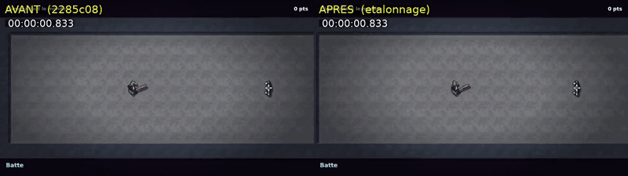
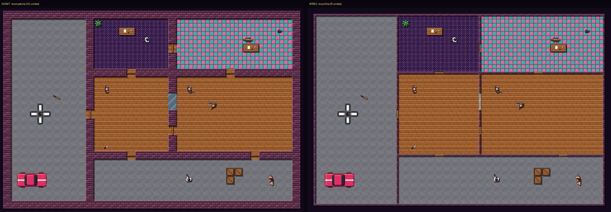

# Étalonnage sur la vidéo de référence : corrections (livrable B)

L'analyse qui justifie chaque correction est dans [`docs/analyse-video-hm.md`](../../analyse-video-hm.md)
(livrable A). Toutes les valeurs visées sont des **plages mesurées sur une vidéo 240p à 30 images/s**,
pas des valeurs officielles. La validation des sensations reste à faire à la main sur macOS.

Branche `claude/hm-video-calibration`, partie de `claude/youthful-noether-typ76w` (commit 2285c08).
Rien n'est fusionné dans `main`.

## Vue d'ensemble

| Lot | Correction | Type | Fichiers |
|---|---|---|---|
| 1 | Vitesse de course | réglage | `Content/Base/characters/player.json` |
| 1 | Suivi de caméra | réglage | `Content/Base/game.json` |
| 2 | Temps de recharge sans perte d'un pas | logique | `src/TopDown.Core/World/Actor.cs` |
| 2 | Cadence de l'arme automatique et du fusil à pompe | réglage | `Content/Base/weapons/firearms.json` |
| 2 | Corps projetés par les coups mortels | réglage | `Content/Base/weapons/firearms.json`, `melee.json` |
| 2 | Ouverture des portes | réglage | `Content/Base/doors/doors.json` |
| 3 | Chute et relevé | animation, réglage | `tools/PlaceholderArt/Rig/HumanClips.cs`, `BaseArt.cs`, `Content/Base/assets.rig.json`, `enemies/humans.json`, `characters/player.json`, `game.json` |
| 4 | Rythme des achèvements à mains nues | réglage | `Content/Base/weapons/natural.json` |
| 8 | Flash du fond sur les éliminations | effet (code et données) | `TopDown.Content/Model.cs`, `Desktop/Screens/PlayScreen.cs`, `Desktop/Graphics/WorldRenderer.cs`, `game.json`, `themes/neon.json` |
| 8 | Points affichés à l'endroit de l'élimination | effet (code et données) | `Core/World/Events.cs`, `Core/World/GameWorld.cs`, `Desktop/Ui/Hud.cs`, `locales/*.json` |
| — | Packs thermiques inchangés | non-régression | `Mods/NoctPrototype/…`, `Mods/NoctInspired/…` |
| 6–7 | Murs fins (collisions, tirs, vue, chemins, rendu) | logique, graphisme, réglage | `Core/Definitions/TileDefinition.cs`, `Core/World/TileMap.cs`, `Core/World/Physics.cs`, `Core/World/LevelBuilder.cs`, `Desktop/Graphics/WorldRenderer.cs`, `Desktop/Ui/DebugOverlay.cs`, `TopDown.Content/ContentValidator.cs`, `Content/Base/tiles/tiles.json` |
| — | Scènes de vérification reproductibles | outil | `tools/CalibrationScenes/` |

## Avant / après dans le jeu

Jeu réel, 1280 × 720, pixel art ×2, pilote automatique. À gauche le commit de départ (2285c08), à droite
cette branche. Timecode depuis la première image de jeu. Scènes : `tools/CalibrationScenes`.



Les deux versions démarrent dans la même scène. À **t = 1,90 s**, l'« avant » arrive tout juste au
premier ennemi. L'« après » l'a déjà tué : le corps glisse, le fond clignote en rouge et « +400 »
s'affiche au point de l'élimination.

| Vidéo | Ce qu'on y compare |
|---|---|
| [`avant_apres_course.mp4`](avant_apres_course.mp4) | course et suivi de caméra ; effets fixés à l'écran coupés pour la mesure (mod `calibration_measure`) |
| [`avant_apres_batte.mp4`](avant_apres_batte.mp4) | trois éliminations à la batte : corps projetés, chute, flash, points |
| [`avant_apres_mains_nues.mp4`](avant_apres_mains_nues.mp4) | coup de poing, chute, achèvement à mains nues (le pilote automatique martèle) |
| [`avant_apres_fusil.mp4`](avant_apres_fusil.mp4) | cadence de l'arme automatique, corps projetés |
| [`apres_batte_images.jpg`](apres_batte_images.jpg) | première élimination image par image (1/30 s) : contact, chute, glissade, flash, couleurs des points |

**Mesures dans ces enregistrements** (corrélation de phase sur les murs, pilote automatique) :
- défilement en course : **0,597 → 0,694** hauteur d'écran/s (référence : 0,65–0,77) ;
- décalage du joueur au centre en courant vers une cible lointaine : **−21,6 % → −17,6 %** de la hauteur
  d'écran. C'est l'avance de visée (25 %) moins le retard de caméra, qui passe de 3,7 % à 7,7 %.

Le flash suit le rendu : sous Xvfb (OpenGL logiciel, moins de 60 images/s), l'alternance enregistrée
n'est pas régulière. Sur une vraie machine, il alterne toutes les 1/30 s.

## Corrections

### 1. Vitesse de course

- **Problème.** La course traverse 0,597 hauteur d'écran par seconde, contre 0,65–0,77 dans la vidéo
  (05:56.0–05:56.77 et 15 fenêtres de défilement régulier).
- **Cause.** Réglage : `speed` 215. Le départ et l'arrêt étaient déjà instantanés (accélération 9000,
  une image), ce n'était pas la cause.
- **Modification.** `speed` 215 → **250** (+16 %), soit 0,694 hauteur d'écran/s et 11,4 largeurs de
  personnage/s (référence : 10–18). Seule la vitesse maximale change, et peu : le reste de la nervosité
  vient des lots 1 (caméra), 2, 3 et 4.
- **Tests.**
  - `Running_crosses_the_screen_at_the_reference_pace` (720p et 1080p) ;
  - `The_player_starts_and_stops_within_two_video_frames` : 0,033 s pour partir, 0,033 s pour s'arrêter ;
  - mesure dans le jeu enregistré : 0,694.
- **Limites.** La largeur d'un personnage dans la vidéo est connue à ±20 %. Les diagonales ne sont pas
  mesurables (elles restent normalisées dans PAIN).
- **Vérifier en jeu.** Scène `cal_run` (§ « Rejouer les scènes ») : traverser la pièce. Puis
  `first_night`.

### 2. Suivi de caméra

- **Problème.** La caméra colle au joueur : retard de 3,7 % de l'écran et rattrapage en 0,19 s. Dans la
  vidéo : 6–10 % et 0,25–0,37 s (05:55.73, 06:03.37). Le joueur ne « prend » jamais d'avance sur l'écran.
- **Cause.** Réglage : `camera.followSharpness` 16.
- **Modification.** `followSharpness` 16 → **9**. Retard de 7,7 % à pleine course, 95 % d'un
  changement de vitesse rattrapé en 0,33 s. L'avance vers la visée ne change pas : on ne peut pas la
  comparer, la distance du curseur est inconnue dans la vidéo.
- **Tests.**
  - `The_camera_trails_a_running_player_like_the_reference` ;
  - mesure en jeu : le joueur est à −17,6 % du centre au lieu de −21,6 %, l'écart venant du retard.
- **Limites.** Mesuré sur deux départs dans la vidéo. Une caméra plus souple peut paraître flottante :
  c'est un réglage JSON à ajuster au ressenti.
- **Vérifier en jeu.** Courir en ligne droite en visant devant soi : le personnage doit sortir nettement du
  centre puis être rattrapé en un tiers de seconde après l'arrêt.

### 3. Temps de recharge qui perdaient un pas de simulation

- **Problème.** Réglée à 15 tirs/s, l'arme n'en tirait que 13,3.
- **Cause.** Logique (`Actor.TickState`). Les temps de recharge sont décomptés par pas de 1/120 s.
  1/15 s vaut exactement 8 pas, mais l'erreur d'arrondi des flottants laissait un reste infime, et le
  tir attendait un 9e pas. Toutes les cadences qui tombent pile sur un nombre de pas étaient touchées.
- **Modification.** `Countdown` : un reste inférieur à 0,1 ms compte comme zéro. Cela s'applique au temps
  de recharge des attaques et à celui des bonds.
- **Tests.** `A_cadence_of_whole_steps_is_kept_exactly` (15, 8 et 4 tirs/s). Il échoue sans la correction
  (14 tirs au lieu de 15) et passe avec.
- **Limites.** Les durées d'état (relevé, étourdissement…) gardent leur propre arrondi d'au plus un pas
  (1/120 s). Elles n'ont pas été modifiées, pour ne pas toucher à des mécaniques qui fonctionnent.
- **Vérifier en jeu.** Tirer en continu avec le fusil automatique : 24 balles partent en 1,6 s.

### 4. Cadence des armes à feu

- **Problème.** Arme automatique : 15 tirs/s dans la vidéo (02:41.828–02:42.095, 10:21.367–10:22.034).
  Fusil à pompe : 0,50–0,53 s entre deux tirs (01:49.543–01:50.577). PAIN : 8 tirs/s et 0,8 s.
- **Cause.** Réglage.
- **Modification.** `rifle.fireRate` 8 → **15** (son chargeur est déjà de 24, comme dans la vidéo) ;
  `shotgun.fireRate` 1,25 → **1,9** (0,53 s). Les ennemis armés tirent au même rythme, comme dans la
  vidéo (04:18.07–04:18.304).
- **Tests.**
  - `The_automatic_rifle_fires_about_fifteen_rounds_a_second` : 15 ;
  - `The_shotgun_pumps_in_about_half_a_second`.
- **Limites.** Rien ne dit que l'arme automatique de la vidéo correspond au « fusil » de PAIN : on a
  réglé l'arme dont le chargeur et le rôle correspondent. Recul, flash et vitesse des balles ne sont pas
  mesurables et n'ont pas été modifiés. Les ennemis armés deviennent nettement plus dangereux.
- **Vérifier en jeu.** Scène `cal_rifle`, puis `warehouse`.

### 5. Corps projetés

- **Problème.** Dans la vidéo, un coup de mêlée mortel projette le corps d'environ une largeur de
  personnage en 2–3 images (06:23.433→.567), et un tir de 1,2–3,5 largeurs (10:08.85, 10:30.8). Dans
  PAIN, les corps glissaient de 0,06 à 0,35 largeur : les coups ne « portaient » pas.
- **Cause.** Réglage. `knockback` trop faible : un mort prend la vitesse du recul, puis freine à
  5000 u/s².
- **Modification.**

  | Arme | `knockback` | Corps projeté (largeurs) |
  |---|---|---|
  | batte | 240 → 520 | 0,14 → 0,95 |
  | tuyau | 220 → 500 | 0,11 → 0,87 |
  | machette | 150 → 480 | (extrapolé) |
  | pistolet | 140 → 650 | 0,06 → 1,80 |
  | revolver | 220 → 700 | (extrapolé) |
  | fusil à pompe | 300 → 800 | 0,35 → 2,76 |
  | pistolet-mitrailleur | 140 → 650 | (extrapolé) |
  | fusil | 140 → 650 | 0,06 → 1,80 |

  Un coup non mortel ne pousse qu'à moitié, comme avant.
- **Tests.** `A_killed_body_is_thrown_like_in_the_reference` (batte, tuyau, pistolet, pompe, fusil).
- **Limites.**
  - La machette, le revolver et le pistolet-mitrailleur ne sont pas identifiables dans la vidéo : leurs
    valeurs suivent celles de leur famille.
  - Le couteau et les poings n'ont pas été modifiés.
  - Le joueur tué est projeté de la même façon, comme dans la vidéo (04:10.833).
- **Vérifier en jeu.** Scène `cal_bat` : chaque corps glisse d'environ sa largeur.

### 6. Ouverture des portes

- **Problème.** Une porte poussée s'ouvre en 2–3 images dans la vidéo (08:49.37–.47, 09:08.017–.050).
  Dans PAIN, il lui fallait 0,142 s, soit 4,2 images, pour atteindre 85°.
- **Cause.** Réglage : `door_wood.pushSpeedDegrees` 620 avec un amortissement de 2,2.
- **Modification.** `pushSpeedDegrees` 620 → **1100**, soit 85° en ≈ 0,085 s. Le seuil de renversement
  (240°/s) et le temps au sol (2,6 s, référence 2,1–3,65 s) ne changent pas. La porte métallique, absente
  de la vidéo, n'a pas été modifiée.
- **Tests.** `A_kicked_wooden_door_swings_open_within_three_video_frames`. Il échoue avec l'ancienne
  valeur (0,142 s) et passe avec la nouvelle.
- **Limites.** La vitesse à laquelle la porte bat contre un personnage augmente : elle renverse un peu plus
  facilement. Les tests des portes sont inchangés et passent.
- **Vérifier en jeu.** Scène `cal_door` : foncer dans la porte, l'ennemi derrière tombe.

### 7. Chute et relevé

- **Problème.**
  - Chute : dans la vidéo, un personnage frappé est couché dès l'image suivante (01:12.406, 08:49.500).
    Dans PAIN, il touchait le sol à 0,14–0,18 s, soit 4–5 images.
  - Relevé : 2–3 images dans la vidéo (10:13.667–.734, 11:35.867–.967), 0,4 s dans PAIN.
- **Cause.**
  - Animation : les images avant le contact au sol (`thud`) duraient 0,14–0,24 s.
  - Réglage : `getUpDuration` par défaut, 0,4 s.
- **Modification.**
  - Le générateur reçoit deux paramètres. `toFloor` ramène le contact au sol à 0,05 s ; `riseIn` ramène
    le relevé à 0,09 s. Les poses sont les mêmes, seules les durées des premières images changent
    (`HumanClips.All`, utilisé par `BaseArt`). Les planches PNG sont identiques : seules les durées de
    19 clips changent dans `assets.rig.json`.
  - `getUpDuration` 0,1 pour le joueur, le garde et le voyou.
  - `feel.fallDuration`, le repli des personnages sans animation : 0,09 → 0,05.
  - Le costaud garde son relevé lourd de 0,4 s : il n'apparaît pas dans la vidéo.
- **Tests.**
  - `A_floored_human_lies_on_the_floor_within_two_video_frames` : 16 animations ;
  - `A_floored_enemy_stands_up_within_three_video_frames` : 0,108 s, dont un pas d'arrondi ;
  - `The_get_up_animation_stands_before_the_character_can_act`.
- **Limites.**
  - Le relevé rapide du joueur est extrapolé : le joueur n'est jamais renversé dans la vidéo.
  - Le temps au sol (2,2–3 s) n'a pas changé, il était déjà dans la plage observée.
  - Les images de chute restent dans les planches. À 60 images/s ou plus, on en voit une ou deux.
- **Vérifier en jeu.** Scène `cal_bare_hands` : un coup de poing et l'ennemi est au sol. Ne pas l'achever,
  attendre ≈ 2,2 s : il se relève presque d'un coup.

### 8. Rythme des achèvements à mains nues

- **Problème.** Dans la vidéo (chapitre 1, masque sans effet), une frappe tombe toutes les 0,30–0,33 s
  et la victime meurt 0,50–0,93 s après la montée (01:13.51, 01:21.01, 01:40.73, 02:09.66). Dans PAIN :
  1,83 s sans cliquer, 0,36 s en martelant le bouton.
- **Cause.** Réglage : `windUp` 0,1, `strikeInterval` 0,12, `autoStrikeDelay` 0,6.
- **Modification.** `windUp` **0,2**, `strikeInterval` **0,2**, `autoStrikeDelay` **0,3**. Il faut
  toujours trois frappes. Le joueur garde la main : cliquer accélère jusqu'à une frappe toutes les 0,2 s,
  sans cliquer elles tombent toutes les 0,3 s.
- **Tests.** `A_bare_handed_execution_kills_in_the_reference_window` : 0,925 s sans clic, 0,625 s en
  martelant. Les tests d'achèvement et de synchronisation existants sont inchangés et passent.
- **Limites.**
  - On ne sait pas si le jeu de référence attend un clic par frappe : son rythme régulier suggère que non,
    sans le prouver.
  - Les achèvements avec une arme ne sont pas observables : non modifiés.
  - Les animations d'achèvement sont calées sur chaque frappe, quelle que soit sa cadence. Entre deux
    frappes plus espacées, elles restent sur leur dernière image.
- **Vérifier en jeu.** Scène `cal_bare_hands` : renverser, Espace, puis ne rien faire ou marteler le
  clic. La mort tombe vers 0,9 s ou vers 0,6 s.

### 9. Flash du fond sur les éliminations

- **Problème.** Dans la vidéo, le fond autour du niveau alterne avec un rouge vif une image sur deux
  pendant 6–10 images sur beaucoup d'éliminations (01:20.647, 01:45.672, 01:49.543, 04:09.84…), mais
  pas sur les coups de poing ni les achèvements. PAIN n'avait rien d'équivalent.
- **Cause.** Fonction absente.
- **Modification.**
  - Nouveau champ `backdrop` (secondes) dans le ressenti d'un impact (`ImpactFeel`), et couleur facultative
    `backdropFlash` dans le thème.
  - `PlayScreen` efface la scène avec cette couleur une fois sur deux, toutes les 1/30 s, en commençant
    allumé. Seuls les impacts auxquels le joueur participe le déclenchent.
  - Le pack action : `feel.kill.backdrop` 0,25 s et `backdropFlash` `#b3122e`. Les achèvements n'en
    déclenchent pas.
  - Le joueur le coupe dans les options : « Flashs lumineux : non ». Ce réglage est **indépendant** des
    tremblements, activé par défaut, et une explication s'affiche sous l'option. Les réglages existants ne
    changent pas : un fichier sans ce champ le garde activé.
- **Tests.** Effet de rendu seulement. Le pack action charge sans avertissement, et les thèmes thermiques
  n'ayant pas de `backdropFlash`, ils ne clignotent pas. Vérifié sur l'enregistrement : premier flash
  sur l'image du coup (t = 1,833 s dans `apres_batte_images.jpg`).
- **Limites.** La règle exacte de la vidéo n'est pas déductible (certains coups de mêlée flashent,
  d'autres non). Ici : toute élimination hors achèvement. Les renversements par une porte, qui flashent
  dans la vidéo, ne flashent pas.
- **Vérifier en jeu.** Scène `cal_bat`. Avec « Flashs lumineux : non », aucun clignotement : vérifié sur un
  enregistrement (3 éliminations, aucune image rouge ; 5 images rouges avec l'option active).

### 10. Points à l'endroit de l'élimination

- **Problème.** Dans la vidéo, « +N PTS » apparaît où la victime tombe, change de couleur toutes les
  2–4 images et reste ≈ 1 s (01:12.406, 10:53.147). PAIN n'affichait que le total.
- **Cause.** Fonction absente : la simulation ne disait pas combien rapportait chaque élimination ni où.
- **Modification.**
  - Événement `PointsScored(Position, Points, Combo, Method)`, émis quand le score est actif.
  - `Hud.ShowPoints` affiche « +400 » au-dessus de la victime pendant 1,1 s. Le texte monte, passe par
    les couleurs `secondary` / `text` / `accent` du thème toutes les 0,08 s, puis s'efface.
  - Texte `hud.points` traduisible.
- **Tests.** `Each_kill_reports_its_points_where_the_victim_fell` (300 puis 600 en combo, position).
  `Score_can_be_disabled` vérifie qu'aucun événement n'est émis sans score.
- **Limites.** PAIN ne donne pas de points pour un renversement (la vidéo, si), et le combo s'affiche
  toujours dans le HUD et non 2 s après la série.
- **Vérifier en jeu.** Scène `cal_bat` : « +400 », « +800 », « +1200 ».

### 11. Murs fins



Autres niveaux : [`murs_demo.jpg`](murs_demo.jpg), [`murs_warehouse.jpg`](murs_warehouse.jpg). Ces images
sont à l'échelle 1, avec les effets fixés à l'écran coupés. À gauche, le même code avec les murs pleins.

- **Problème.** Dans la vidéo, les murs sont deux traits clairs de 0,2 à 0,45 largeur de personnage
  (04:17.0, 10:10.0), les pièces sont vastes et l'extérieur est un fond uni. Dans PAIN, chaque mur était une
  tuile pleine de 32 unités, soit 1,45 largeur de personnage : des bandes épaisses qui mangeaient l'espace
  et la lisibilité.
- **Cause.** Architecture : un mur ne pouvait être qu'une tuile entière.
- **Modification.**
  - Nouveau champ `thickness` sur les tuiles de mur.
  - `TileMap.Solids` calcule la partie pleine de chaque tuile. C'est la zone de murs réduite de
    (tuile − épaisseur) / 2 sur ses bords libres : une bande centrée dans une ligne de murs, un L dans un
    angle, un T à une jonction, un bloc plein à l'intérieur d'une masse de murs. Les **embrasures de porte**
    comptent comme du mur, si bien que la bande va jusqu'à la porte, centrée sur la même ligne qu'elle.
  - Tout le moteur utilise cette forme :
    - les collisions des personnages (`Physics.ResolveStatic`) ;
    - les tracés de tirs, de vue, de portée des coups et des lancers (`TileMap.Raycast`, qui ne s'arrête
      sur une tuile fine que si le segment croise sa bande).
  - Les tuiles entières gardent exactement l'ancien calcul.
  - Le rendu :
    - dessine le mur seulement dans ses bandes, texture recadrée, liseré et ombre sur les faces exposées ;
    - fait passer sous la partie libre le sol de la pièce qui la borde, quart par quart, y compris dans
      les embrasures ;
    - laisse le fond à l'extérieur.
  - Le validateur signale deux murs fins qui ne se touchent que par un coin, car ils laisseraient un passage.
  - Pack action : murs blancs, briques, plâtre et vitres à **8 unités** (0,36 largeur de personnage).
  - Packs thermiques : leurs tuiles restent pleines.
- **Tests.**
  - `ThinWallTests`, 13 tests :
    - formes en ligne, en angle, en T, en bloc et au bord de la carte ;
    - jonction avec une porte, et forme recalculée quand une tuile change (vitre brisée) ;
    - un personnage entre dans la partie libre d'une tuile de mur et s'arrête sur la bande ;
    - les tracés s'arrêtent sur la bande avec la bonne normale et passent à côté ;
    - la vue passe au bout d'un mur ;
    - un chemin part de l'intérieur d'une tuile de mur ;
    - on franchit une porte ;
    - l'avertissement du validateur.
  - `Walls_are_as_thin_as_in_the_reference`, et `Every_door_of_the_action_levels_meets_its_walls` : aucune
    porte des cinq niveaux n'a d'interstice.
  - Les tests existants (portes, vitres, IA, groupes, niveaux livrés) passent sans modification.
- **Limites.**
  - Les pièces gagnent 12 unités de chaque côté. Les meubles posés contre un mur en sont donc décollés
    d'autant ; les niveaux n'ont pas été retouchés.
  - Le chemin de l'IA traite toujours les tuiles de mur comme infranchissables. C'est prudent : il ne
    passe simplement pas par leur partie libre.
  - Deux murs fins ne se rejoignent pas en diagonale. Aucun niveau livré n'en a, et le validateur le signale.
- **Vérifier en jeu.** N'importe quel niveau du profil action, par exemple `first_night` ou `demo`. Longer
  un mur, tirer le long d'un mur, passer une porte. La touche de débogage des collisions dessine désormais
  les bandes réelles.

### Packs thermiques

Les deux packs thermiques héritent des définitions du pack de base, champ par champ : toute valeur
modifiée dans le pack de base leur parvient, qu'un de leurs niveaux s'en serve ou non. Une revue de la PR
a relevé des oublis dans la première version. Le survivant héritait d'un relevé de 0,1 s alors que son
animation dure 0,355 s ; le fusil, le pistolet-mitrailleur, le revolver, la batte, le garde et le voyou
étaient aussi touchés.

**Correction.** La protection est désormais générale.
- `ThermalProfileTests.The_thermal_profiles_load_exactly_what_they_loaded_before_the_calibration` compare
  **toutes les valeurs effectivement chargées** par les profils `noct` et `signal` à un instantané pris
  sur le contenu d'avant l'étalonnage (commit 2285c08), avec le code actuel. Il couvre :
  - chaque arme, personnage, tuile, porte, modificateur et niveau ;
  - les règles, le fichier `game.json` (caméra, ressenti…) et le thème actif ;
  - chaque animation.

  L'instantané (`tests/TopDown.Tests/Snapshots/thermal_profiles.json`, une empreinte par valeur) se
  régénère avec `THERMAL_SNAPSHOT_FROM=<copie du commit 2285c08>`. Le test cite chaque valeur qui
  diffère.
- Pour qu'il passe, chaque valeur modifiée est figée à son ancienne valeur dans les deux mods :
  - armes `pistol`, `shotgun`, `rifle`, `smg`, `revolver`, `bat`, `pipe`, `machete` et
    `unarmed.execution` ;
  - `player`, `guard` et `thug` (`getUpDuration` 0,4) ;
  - `door_wood` ;
  - `feel.fallDuration` et `feel.kill.backdrop` ;
  - les cinq tuiles de mur et de vitre (`thickness: null`, tuiles pleines).
- `Every_human_stands_up_before_it_can_act_again` vérifie, dans les trois profils, que l'animation de
  relevé de chaque humain atteint sa pose debout avant la fin de l'état « se relève ». Avant la
  correction, ce test échouait pour le survivant des deux packs thermiques.

## Tests et vérifications

| Vérification | Résultat |
|---|---|
| `dotnet build TopDown.slnx -c Release` | réussi, 0 avertissement (`TreatWarningsAsErrors`) |
| `dotnet test tests/TopDown.Tests` | **320 réussis**, 0 échec. 50 nouveaux cas : 28 dans `ReferenceCalibrationTests`, 13 dans `ThinWallTests`, 5 dans `ThermalProfileTests`, 3 cas de cadence dans `ResponsivenessTests`, 1 dans `GameplayTests` (et 1 test complété) |
| Avant correction | sur le commit de départ, 12 des 15 premiers tests d'étalonnage échouaient, avec les valeurs « avant » citées plus haut |
| Jeu réel, pilote automatique | avec les murs fins : `action/first_night`, `warehouse`, `offices` (300 images), `demo`, `arena` (600), `signal/outpost`, `tunnels` (300), `noct/installation` (mission entière, 4200), `noct/noct_demo` (600). Code de retour 0, aucun avertissement |
| Scènes d'étalonnage | les 5 scènes chargent et tournent (`The_calibration_scenes_load_and_play`) |

**Non vérifié.** Une vraie machine avec carte graphique (alternance régulière du flash, 60 images/s et
plus), le son, et la sensation de jeu : c'est la validation manuelle sur macOS.

## Rejouer les scènes (macOS ou autre)

Depuis la racine du dépôt :

```bash
dotnet build TopDown.slnx -c Release
```

```bash
dotnet src/TopDown.Desktop/bin/Release/net10.0/TopDown.dll --profile action --mods tools/CalibrationScenes --mod calibration --level cal_bat
```

Remplacer `cal_bat` par `cal_bare_hands`, `cal_rifle`, `cal_run` ou `cal_door`. Ajouter `--autopilot`
pour que le jeu joue seul. Ajouter `--mod calibration_measure` pour couper la vignette, le grain et les
lignes de balayage, comme pour les mesures.

Pour comparer avec l'avant, dans une copie séparée :

```bash
git worktree add ../pain-avant 2285c08
```

Puis lancer la même commande depuis `../pain-avant`, après l'y avoir compilé. Les scènes sont lues depuis
`tools/CalibrationScenes` : donner leur chemin absolu à `--mods`.

Toutes les valeurs sont dans le JSON. Les ajuster ne demande pas de recompiler, seulement de relancer
(`Content/` est copié à côté de l'exécutable par la compilation ; on peut aussi pointer `--content`
vers le dossier `Content` du dépôt).
